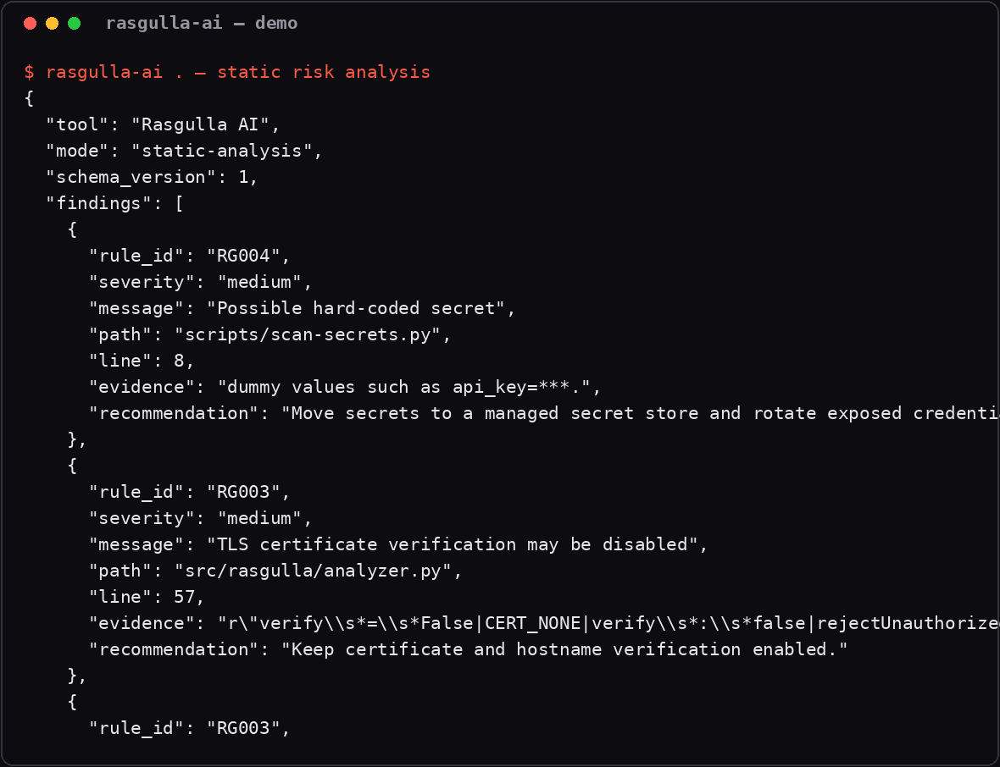

# Rasgulla AI

[](https://github.com/gravion-ux/rasgulla-ai/actions/workflows/ci.yml)



*Demo: Local-first static risk analysis of a project tree.*

> A local-first AI-assisted security research workbench for code understanding, safe test generation, and reproducible debugging.

**Status:** MVP scaffold / research prototype. Not production-certified.

## Features
- Source-code inventory and heuristic risk hints.
- Explainable findings with file/line evidence.
- **AI/LLM-specific rules**: prompt injection, sensitive data in prompts, excessive agency, model supply chain, poisoning, unbounded consumption, improper output handling and hidden context exposure.
- **Agent-runtime rules**: MCP servers, hook scripts, skill manifests and agent settings — the files that only exist once a model can call tools, read files and install instructions.
- **Triage metadata on every finding**: severity, confidence, CWE and — where the weakness is specific to LLM-backed applications — an OWASP Top 10 for LLM Applications category with reference links.
- **Rules scoped to the files they mean something in**, so a skill manifest is read as a manifest and not as prose.
- Safe local test-plan generation.
- Provider-neutral model adapter interface (no API key required for static mode).
- Redacted evidence: a detected secret value is never copied into the report.
- An inline `# rasgulla: ignore` marker for the lines a reviewer has looked at.

## Quick start

```bash
python -m venv .venv
source .venv/bin/activate
# Windows: .venv\\Scripts\\activate
pip install -e ".[dev]"
pytest
```

## Command-line usage

```bash
rasgulla ./src                                # analyze a directory and print the report
rasgulla ./src --output report.json           # also write the report to a file
rasgulla ./src --test-plan                    # add a local, offline test plan
rasgulla ./src --test-plan --adapter static   # choose the adapter (static or null)
rasgulla ./src --test-plan --max-steps 10     # cap the number of plan entries
rasgulla ./src --fail-on-findings             # exit 1 when at least one finding is reported
```

| Exit code | Meaning |
| --- | --- |
| `0` | The scan ran and the report was produced. |
| `1` | The report could not be written, or `--fail-on-findings` was given and findings exist. |
| `2` | The command line itself was wrong: a path that does not exist, an unknown adapter, or a negative `--max-steps`. |

Problems are reported as one-line messages. The command never prints a Python
traceback, so it can be used directly in a CI pipeline.

## Rules

Severity is how bad it is if true; confidence is how sure the matcher is. A
low-confidence rule is a prompt to look, not a conclusion.

| Rule | Severity | Confidence | Detects | CWE | OWASP LLM |
| --- | --- | --- | --- | --- | --- |
| `RG001` | high | high | Dynamic evaluation (`eval(`). | CWE-95 | — |
| `RG002` | high | high | Process execution primitives (`exec(`, `system(`). | CWE-78 | — |
| `RG003` | medium | high | TLS certificate or hostname verification disabled, in Python, Node.js, Go, curl and common configuration spellings. | CWE-295 | — |
| `RG004` | medium | medium | Possible hard-coded secret, in assignment and YAML form. The value is redacted in the report. | CWE-798 | LLM02 |
| `RG005` | high | high | A child process started with the shell interpreter enabled. | CWE-78 | — |
| `RG006` | high | high | Unsafe deserialization (`pickle.loads`, `yaml.load`) or dynamic code construction (`new Function(`). | CWE-502 | LLM05 |
| `RG007` | high | medium | A prompt built from untrusted input — f-string, `.format()` or concatenation. | CWE-1427 | LLM01 |
| `RG008` | medium | medium | A secret or personal record interpolated into a prompt. | CWE-201 | LLM02 |
| `RG009` | high | medium | An agent granted every tool, or allowed to act without confirmation. | CWE-250 | LLM03 |
| `RG010` | high | high | Model loading that trusts remote code (`trust_remote_code=True`). | CWE-829 | LLM04 |
| `RG011` | medium | low | A model or dataset fetched without a pinned revision. | CWE-829 | LLM04 |
| `RG012` | high | high | A model or dataset artifact loaded without verification (`torch.load`, `joblib.load`, `np.load(allow_pickle=True)`). | CWE-502 | LLM05 |
| `RG013` | medium | medium | An HTTP request made without an explicit timeout. | CWE-770 | — |
| `RG014` | low | low | A model call with neither an output cap nor a timeout. | CWE-770 | LLM06 |
| `RG015` | high | high | Model output handed to `eval`, `exec`, a shell or a subprocess. | CWE-94 | LLM10 |
| `RG016` | high | medium | A query built by string interpolation instead of parameters. | CWE-89 | — |
| `RG017` | medium | medium | A system prompt or conversation history written to a log. | CWE-532 | LLM08 |
| `RG018` | low | low | Vector retrieval that runs without a filter. | CWE-862 | LLM09 |
| `RG019` | high | high | A LangChain execution utility (`PythonREPL`, `BashProcess`, `PythonAstREPLTool`) given to an agent. | CWE-94 | LLM03 |
| `RG020` | medium | low | A model call inside a `while True:` loop with no visible exit. | CWE-835 | LLM06 |
| `RG021` | high | medium | An MCP tool result that carries a credential back to the model. | CWE-522 | LLM02 |
| `RG022` | high | medium | A tool description or skill manifest carrying hidden instructions. | CWE-1427 | LLM01 |
| `RG023` | high | high | A plaintext provider key in an MCP configuration file. | CWE-798 | LLM04 |
| `RG024` | high | high | A hook that pipes a downloaded script straight into a shell. | CWE-829 | LLM04 |
| `RG025` | high | medium | A hook that allows a tool call without checking it. | CWE-862 | LLM03 |
| `RG026` | high | medium | A hook that carries data out through a DNS lookup. | CWE-201 | LLM02 |
| `RG027` | high | medium | A skill manifest that sends the agent to a credential file. | CWE-522 | LLM02 |
| `RG028` | high | medium | A skill manifest that sends data to a remote endpoint. | CWE-201 | LLM02 |
| `RG029` | medium | medium | A skill manifest that embeds an encoded payload to decode and run. | CWE-506 | LLM01 |
| `RG030` | high | high | Invisible or bidirectional characters in an agent configuration file. | CWE-176 | LLM01 |
| `RG031` | high | high | Every MCP server of a project enabled without confirmation. | CWE-862 | LLM03 |
| `RG032` | high | high | The permission or sandbox control of the agent switched off. | CWE-862 | LLM03 |

### Where a rule looks

A rule is not meant to fire everywhere. `RG024` describes a hook script, and a
shell hook does not appear in a Python module; `RG027` describes a skill
manifest, and a manifest is not a source file. Each rule therefore carries a
scope, and the scanner only applies the rule to the files where its signal
means something:

| Scope | Files it covers |
| --- | --- |
| *(none)* | Every source file. |
| `source` | Every source file. |
| `manifest` | The agent manifests: `SKILL.md`, `AGENT.md`, `AGENTS.md`, `CLAUDE.md`, `GEMINI.md`, `.cursorrules`, `.clinerules`, `.windsurfrules`, `*.mdc` and `*copilot-instructions*`. |
| `.py`, `.sh`, `.json`, … | Every file with that extension. |
| `*mcp*.json`, `claude_desktop_config.json` | Every file whose name matches the pattern. |

The manifest files have their own scan scope. They are read as instructions
by an agent, so they are worth scanning — but they are not source code, and
pulling every Markdown file into the source-code scan would drown the report
in prose matches.

### Silencing a line

A reviewed line can opt out of the scanner with an explicit marker:

```python
eval(user_input)  # rasgulla: ignore
```

The marker silences that line only. It is never inferred, and it is not a
default: a finding the reviewer has not looked at stays in the report.

The OWASP column names the category of the [Top 10 for LLM Applications
2026](https://genai.owasp.org/top-10-for-llm-applications-2026/): LLM01 Prompt
Injection, LLM02 Sensitive Information Disclosure, LLM03 Excessive Agency,
LLM04 Supply Chain, LLM05 Data and Model Poisoning, LLM06 Unbounded
Consumption, LLM07 Misinformation, LLM08 Hidden Context Exposure, LLM09 Vector
and Embedding Weaknesses, LLM10 Improper Output Handling.

The CWE column names the weakness that MITRE's Common Weakness Enumeration
describes. Only identifiers MITRE still accepts for vulnerability mapping are
used: an identifier it marks *discouraged* points at a catch-all class
rather than at the defect, so it would not tell a reviewer what to fix.

A placeholder value such as `your_password_here`, `changeme` or `example-token`
is not reported as a secret.

## The report

The report is versioned. `schema_version` is `2`.

```json
{
  "tool": "Rasgulla AI",
  "mode": "static-analysis",
  "schema_version": 2,
  "summary": {
    "total": 2,
    "by_severity": {"high": 1, "medium": 1, "low": 0, "info": 0},
    "by_confidence": {"high": 1, "medium": 1, "low": 0},
    "by_owasp_llm": {"LLM10": 1}
  },
  "rules": [{"rule_id": "RG001", "severity": "high", "confidence": "high",
             "message": "…", "recommendation": "…", "pattern": "…",
             "cwe": "CWE-95", "owasp_llm": "",
             "owasp_llm_name": "", "references": ["…"]}],
  "findings": [{"rule_id": "RG001", "severity": "high", "message": "…",
                "path": "app.py", "line": 3, "evidence": "eval(user_input)",
                "recommendation": "…", "confidence": "high",
                "cwe": "CWE-95", "owasp_llm": "", "owasp_llm_name": "",
                "references": ["…"]}],
  "notice": "…"
}
```

`rules` is the catalogue of everything the scanner can report, so a consumer
can render the taxonomy without hardcoding it; `summary` is the triage view.
Each catalogue entry carries the recommendation and the pattern as well, so a
consumer can show what to fix and what was matched without a second lookup.

## Not covered

**LLM07 (Misinformation)** has no static signal — a model that answers wrongly
looks exactly like a model that answers rightly in the source code. It needs
evaluation against a test set, not a scanner. The same applies to the data
flow *through* an API: these rules match spellings of dangerous APIs, so they
find the seam, not the exploit.

**Data flow** is not followed. A rule that needs to know where a value came
from — a parameter that reaches a command, a secret that reaches a prompt
through three calls — is not reported, because a line-level matcher would
fire on every call and drown the report. The rules are a prompt to look, not
a proof of exploitability.

## Python API

```python
from pathlib import Path

from rasgulla import analyze_path, build_test_plan, get_adapter

findings = analyze_path(Path("./src"))
for finding in findings:
    print(finding["rule_id"], finding["path"], finding["line"], finding["message"])

plan = get_adapter("static").generate_test_plan(findings)
assert plan == build_test_plan(findings)
```

The `static` adapter is deterministic and completely offline: it needs no model,
no network and no API key. Another provider can be plugged in by implementing
the `ModelAdapter` protocol and registering it in `ADAPTERS`.

## Safety and scope
The MVP performs static inspection only. It does not execute generated code, exploit targets, access networks, collect credentials, or bypass model safeguards. Treat findings as hypotheses requiring human validation.

## Roadmap
- [x] Stable public API and versioned schemas
- [x] More unit, integration and adversarial tests
- [x] AI/LLM rule set with OWASP LLM Top 10 and CWE mapping
- [x] Agent-runtime rules for MCP servers, hooks, skills and agent settings
- [ ] Reproducible benchmarks and sample datasets
- [ ] Signed releases and dependency review
- [x] Documentation and contribution guide

## License
MIT. See [LICENSE](LICENSE). The license file carries the complete MIT text, including the warranty and liability clauses.
